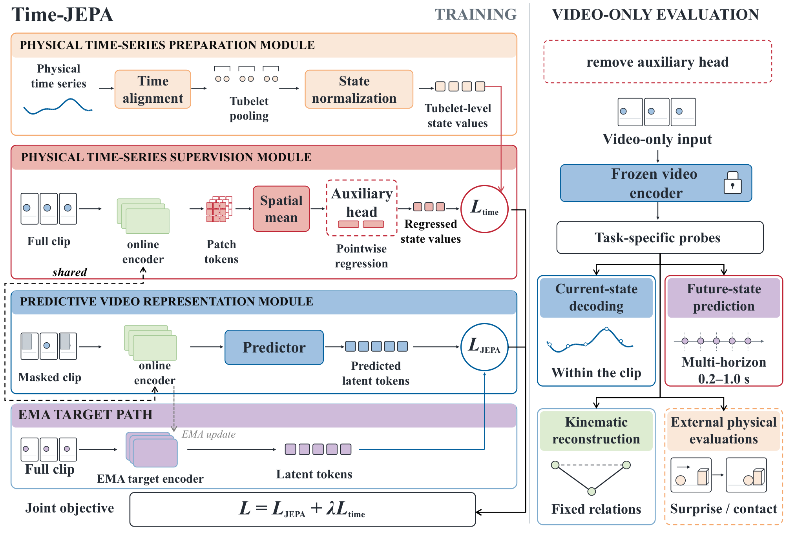
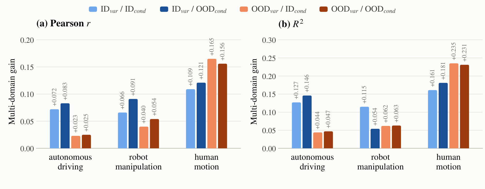
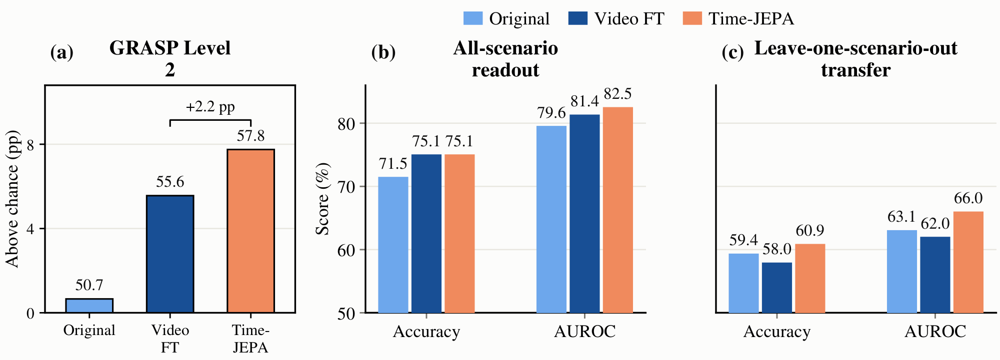

<div align="center">

# Time-JEPA

### Grounding Video World Models with Physical Time Series

**Physical time-series supervision for video world models · Video-only evaluation**

[Shenyi Li](https://openreview.net/profile?id=~Shenyi_Li1)<sup>*</sup>,
[Ziyang Zhang](https://openreview.net/profile?id=~Ziyang_Zhang5)<sup>*</sup>,
[Wen Wu](https://openreview.net/profile?id=~Wen_Wu2),
[Ming Liu](https://openreview.net/profile?id=~Ming_Liu6),
[Chao Zhang](https://openreview.net/profile?id=~Chao_Zhang20)<sup>†</sup>

Harbin Institute of Technology · Tsinghua University · Shanghai Artificial Intelligence Laboratory

<sup>*</sup> Equal contribution &nbsp; <sup>†</sup> Corresponding author

[Overview](#overview) · [Results](#results) · [Quickstart](#quick-integration-check) · [Reproduction guide](docs/reproduction.md) · [Citation](#citation)

</div>

> **Publication status:** Manuscript under review at ICLR 2027. The arXiv submission is in progress; the preprint link will be added once available.

## Overview

**Time-JEPA fine-tunes a video world model with temporally aligned physical time series as auxiliary supervision.** The video encoder learns from both masked latent prediction and physical-state regression. The auxiliary head is removed for evaluation, which uses video as the encoder's only input.



*Training combines the JEPA objective with regression of aligned, pooled and normalized physical state values. Frozen video representations are evaluated through current-state decoding, future-state prediction, kinematic reconstruction and external physical tasks.* [Figure PDF](docs/assets/architecture.pdf)

- **One supervision interface across three domains:** autonomous driving, robot manipulation and human motion.
- **Two distribution-shift axes:** held-out conditions or camera views, and physical variables not used in auxiliary supervision.
- **Four evaluation tasks:** current-state decoding, multi-horizon future-state prediction, kinematic reconstruction and external physical evaluations on GRASP and Physion.
- **Backbone transfer:** experiments use V-JEPA 2.1, with additional evaluation on iVideoGPT.

## Data and evaluation settings

The counts below describe the selected fine-tuning data in the paper, rather than the full source datasets. Supervised variables define **ID variables**; variables excluded from auxiliary supervision define **OOD variables**. Conditions and camera views define a separate ID/OOD axis.

| Domain | Source dataset | Fine-tuning data | ID / OOD variable dimensions | ID conditions | OOD conditions |
|---|---|---:|---:|---|---|
| Autonomous driving | CoVLA | 6,305 videos | 3 / 3 | Source-condition clips | Stable-rain clips |
| Robot manipulation | AgiBot | 15,000 samples | 18 / 8 | Three regular camera views | Two fisheye camera views |
| Human motion | Ego-Exo4D | 7,000 windows | 9 / 5 | Three seen views | Held-out view03 |

Physical time series include vehicle dynamics, robot proprioception and pose-derived human kinematics. Training and evaluation sample 64 frames at 5 FPS per clip. See [data preparation](docs/data.md) for official dataset access, preprocessing and the fixed split-generation recipes. CoVLA/Ego-Exo4D metadata is generated locally; retained AgiBot metadata has its own [license terms](DATA-LICENSES.md).

## Results

These are **reported paper results**, using frozen task-specific probes. They are separate from the bounded quickstart's integration-check scores. **Original** denotes pretrained V-JEPA 2.1; **Video FT** is the matched video-only fine-tuning control.

### Current-state decoding

The following comparison uses **ID variables under ID conditions** with single-domain fine-tuning. Higher Pearson correlation (*r*) and R² are better. Metrics are averaged equally over camera views and physical variables.

| Domain | Metric | Original | Video FT | Time-JEPA |
|---|---|---:|---:|---:|
| Autonomous driving | Pearson *r* ↑ | 0.804 | 0.817 | **0.916** |
| Autonomous driving | R² ↑ | 0.698 | 0.713 | **0.849** |
| Robot manipulation | Pearson *r* ↑ | 0.609 | 0.639 | **0.845** |
| Robot manipulation | R² ↑ | 0.389 | 0.424 | **0.725** |
| Human motion | Pearson *r* ↑ | 0.500 | 0.503 | **0.589** |
| Human motion | R² ↑ | 0.228 | 0.231 | **0.345** |

<details>
<summary><strong>Expand OOD current-state decoding results</strong></summary>

Each score is **Pearson r / R²**. Both metrics are higher-is-better. The protocol and averaging match the ID comparison above.

| Conditions | Variables | Domain | Original | Video FT | Time-JEPA |
|---|---|---|---:|---:|---:|
| ID | OOD | Autonomous driving | 0.879 / 0.771 | 0.885 / 0.783 | **0.920 / 0.846** |
| ID | OOD | Robot manipulation | 0.641 / 0.422 | 0.654 / 0.440 | **0.743 / 0.572** |
| ID | OOD | Human motion | 0.434 / 0.132 | 0.434 / 0.133 | **0.504 / 0.222** |
| OOD | ID | Autonomous driving | 0.800 / 0.685 | 0.812 / 0.699 | **0.902 / 0.824** |
| OOD | ID | Robot manipulation | 0.236 / 0.002 | 0.243 / -0.001 | **0.492 / 0.085** |
| OOD | ID | Human motion | 0.480 / 0.189 | 0.486 / 0.199 | **0.581 / 0.332** |
| OOD | OOD | Autonomous driving | 0.894 / 0.799 | 0.901 / 0.812 | **0.937 / 0.876** |
| OOD | OOD | Robot manipulation | 0.373 / 0.093 | 0.402 / 0.127 | **0.555 / 0.205** |
| OOD | OOD | Human motion | 0.450 / 0.127 | 0.452 / 0.135 | **0.515 / 0.225** |

</details>

### Multi-domain training



*Absolute gains in Pearson r and R² from multi-domain Time-JEPA over matched single-domain Time-JEPA. The four colors distinguish ID/OOD combinations for variables and conditions.* [Figure PDF](docs/assets/multidomain.pdf)

### Kinematic reconstruction

Lower mean absolute error (MAE) is better. Values are **mean ± sample standard deviation over five probe seeds**. Video FT and Time-JEPA use multi-domain training; within each seed, the three metrics average three prediction horizons, two arms and four limbs, respectively.

| Conditions | Domain | Metric ↓ | Original | Video FT | Time-JEPA |
|---|---|---|---:|---:|---:|
| ID | Autonomous driving | Trajectory MAE (m) | 4.423 ± 0.115 | 3.932 ± 0.123 | **1.795 ± 0.027** |
| ID | Robot manipulation | Reach-rate MAE (cm/s) | 5.523 ± 0.010 | 5.372 ± 0.008 | **2.290 ± 0.006** |
| ID | Human motion | Distance MAE (cm) | 6.877 ± 0.093 | 6.815 ± 0.110 | **4.619 ± 0.065** |
| OOD | Autonomous driving | Trajectory MAE (m) | 4.829 ± 0.199 | 4.150 ± 0.146 | **1.858 ± 0.144** |
| OOD | Robot manipulation | Reach-rate MAE (cm/s) | 5.901 ± 0.030 | 5.822 ± 0.035 | **4.171 ± 0.046** |
| OOD | Human motion | Distance MAE (cm) | 7.229 ± 0.177 | 7.120 ± 0.210 | **4.557 ± 0.053** |

### External physical evaluations



*GRASP Level 2 measures macro pair accuracy over eight properties and 2,048 matched possible–impossible video pairs. Bars show percentage points above 50% chance; labels give absolute accuracy. Physion v1.5 uses chronological input and equal averaging over seven scenarios, with all-scenario readout and leave-one-scenario-out transfer. Time-JEPA ties Video FT on all-scenario Accuracy and improves AUROC and transfer scores.* [Figure PDF](docs/assets/external-evaluation.pdf)

The figure sources and render settings are recorded in [asset provenance](docs/assets/README.md). Exact configurations and encoder/resource associations are listed in [the formal experiment index](docs/experiments.md).

## Installation

Use Python 3.11. `requirements.txt` records the package versions exported from the existing `jepa` environment, including PyTorch 2.9.0/CUDA 12.8. `environment-jepa.json` records the Conda package inventory for provenance; it is not a Conda environment YAML.

```bash
python -m pip install -r requirements.txt
python -m pip install -e . --no-deps
```

Install FFmpeg separately for the timestamp-aligned decoding paths. Run commands from this repository root.
Third-party sources, video datasets, pretrained weights and adapted weights are not included. See [dependency preparation](docs/dependencies.md) and [data preparation](docs/data.md).

## Quick integration check

```bash
# Preview without datasets, weights or a GPU.
python scripts/quickstart.py --dry-run

# After obtaining CoVLA under its official terms, generate the fixed splits locally.
python scripts/prepare_metadata.py covla --dataset-root /path/to/CoVLA-Dataset

# On an allocated GPU, using externally supplied resources.
python scripts/quickstart.py \
  --covla-root /path/to/CoVLA-Dataset \
  --encoder-checkpoint /path/to/last.pth.tar
```

This runs one epoch on two training videos, one validation video and one video each for ID/rainy OOD evaluation. See [quickstart.md](docs/quickstart.md) for input checks, output files and evaluation without retraining. Quickstart scores are not paper results.

## Training and probing

Prepare the data, locally generated CoVLA/Ego-Exo4D splits and the official `vjepa2_1_vitg_384.pt` checkpoint first. See [data.md](docs/data.md) for the fixed recipes. Edit the data/checkpoint/output paths in the selected YAML if needed; published configurations use repository-relative paths.

```bash
# Example: CoVLA Time-JEPA fine-tuning. The reported main training setup uses 8 GPUs.
torchrun --standalone --nproc_per_node=8 covla_jepa_rjob/train_from_yaml.py \
  --fname configs/train_time_jepa/weather_ood/covla_vitg384_64f_time_jepa_conv1x1_final.yaml

# Frozen current-state probe.
python covla_probe_rjob/train_covla_probe.py \
  --config covla_probe_rjob/configs/covla/weather_ood/readout/time/covla_readout_conv.yaml

# Frozen five-horizon future-state probe.
python covla_probe_rjob/train_covla_probe.py \
  --config covla_probe_rjob/configs/future_state_1s/mix_e19/covla/readout.yaml
```

The probe configurations refer to adapted encoder aliases named `last.pth.tar` or `last.pt`. Official pretrained filenames are preserved. Adapted iVideoGPT uses `last/transformer/model.safetensors` with its accompanying config and adaptation manifest. **These are release aliases for the paper-selected checkpoints; they do not redefine checkpoint selection as the final training epoch.** See [checkpoint conventions](docs/checkpoints.md).

## Repository guide

| Location | Purpose |
|---|---|
| `app/`, `src/` | V-JEPA 2.1 training, Time-JEPA targets, losses and data handling |
| `configs/train_time_jepa/` | Selected single-domain, multi-domain and reported ablation training configurations |
| `covla_probe_rjob/` | Shared current/future-state probe implementation and configurations |
| `physics_consistency/` | Independent probes, GT-gate generation and kinematic reconstruction |
| `grasp_eval_rjob/`, `physion_ocp_rjob/` | External physical evaluations |
| `world_model_probe_rjob/` | InternVideo-Next, VideoMAE V2 and iVideoGPT adapters |
| `external_baselines/psg_jepa/` | PSG-JEPA adaptation and probing |
| `time-jepa/splits/`, `time-jepa/cache/` | Included AgiBot metadata and destinations for locally generated CoVLA/Ego-Exo4D metadata |
| `scripts/` | Data-independent validation, dependency preparation and result summaries |

Original module names are retained so the selected implementation keeps its import relationships. Cluster submission scripts and historical experiment logs are excluded.
Use [the formal experiment index](docs/experiments.md) for exact training/probe/encoder associations and [the encoder/resource catalog](docs/models.md) for required inputs. The same mappings are available as [CSV](docs/experiment-index.csv) and [JSON](docs/experiment-index.json). See [the reproduction guide](docs/reproduction.md) for execution order.

## Validation

```bash
python scripts/validate_release.py
python -m pip install -r requirements-dev.txt
python -m pytest tests covla_probe_rjob/tests
```

No data or weights are required for the static validation and retained synthetic protocol tests. Full training/evaluation additionally requires the resources listed in the documentation.

A real CoVLA/H200 integration run has also passed; see [the acceptance record](docs/acceptance.md).

## Clean release package

```bash
python scripts/validate_release.py
python scripts/package_release.py
```

This builds a manifest-selected directory and archive under `releases/`, excluding data, weights, local acceptance outputs, symlinks and Git history. See [release.md](docs/release.md).

## Provenance

`release-manifest.json` records source files, selection reasons and checksums. `third-party.json` records the inspected upstream revisions. The included license files retain upstream V-JEPA notices. Confirmed authors/repository and the pending preprint link are recorded in `publication.json`; the release workflow is described in [publication.md](docs/publication.md).

Source-data access and metadata redistribution are separate from the code license. Retained AgiBot metadata uses CC BY-NC-SA 4.0; CoVLA/Ego-Exo4D split lists, per-sample manifests and statistics are generated locally. See [DATA-LICENSES.md](DATA-LICENSES.md) and [data preparation](docs/data.md).

## Citation

If you use this implementation, cite the repository using [CITATION.cff](CITATION.cff) or GitHub's **Cite this repository** button. The paper citation and arXiv link will be added once the preprint identifier is available.

## Acknowledgements and licenses

This implementation builds on V-JEPA 2.1. Upstream notices are retained in [LICENSE](LICENSE), [APACHE-LICENSE](APACHE-LICENSE) and [NOTICE](NOTICE); external adapters and pinned dependencies are described in [third-party.json](third-party.json). Dataset access and metadata redistribution follow the separate terms in [DATA-LICENSES.md](DATA-LICENSES.md).
